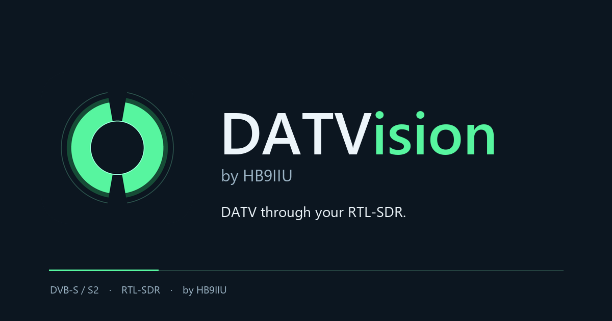
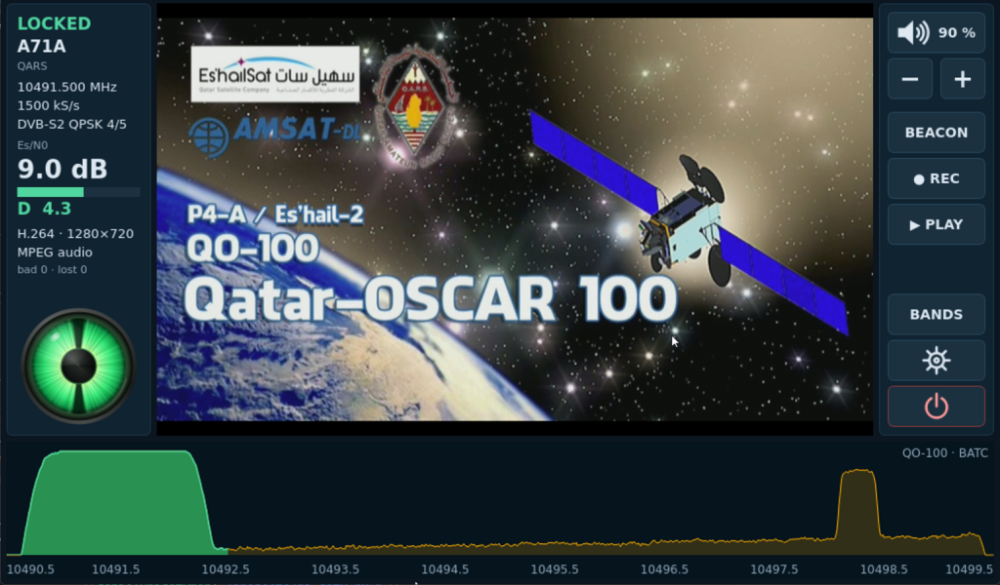
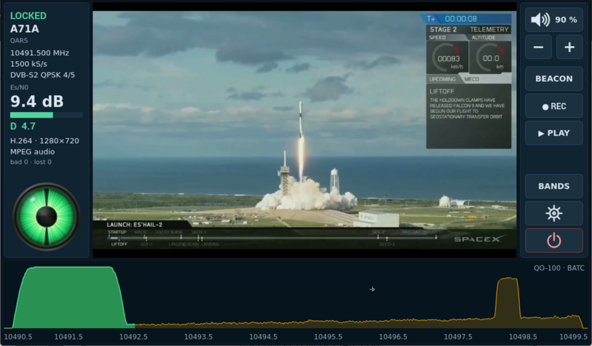
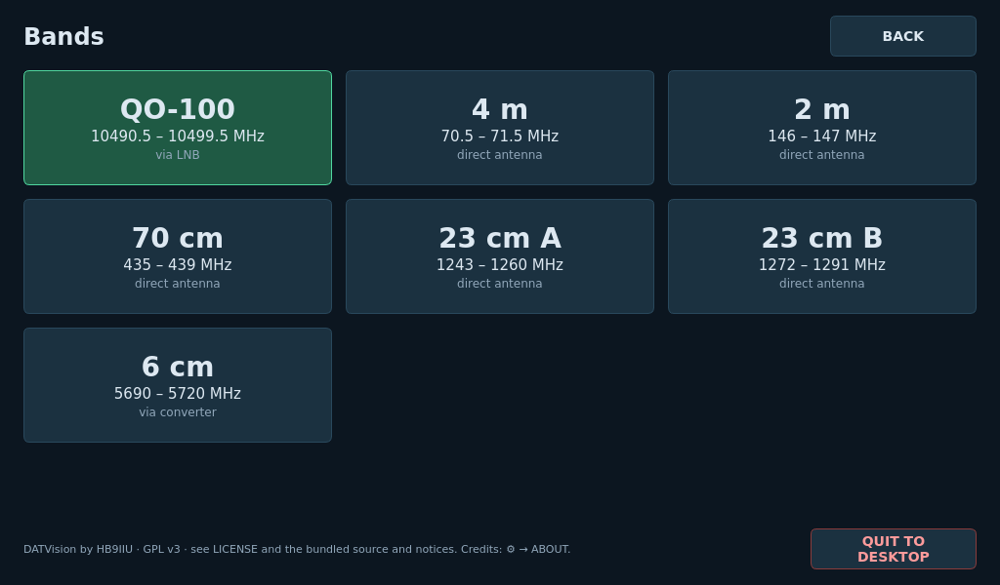
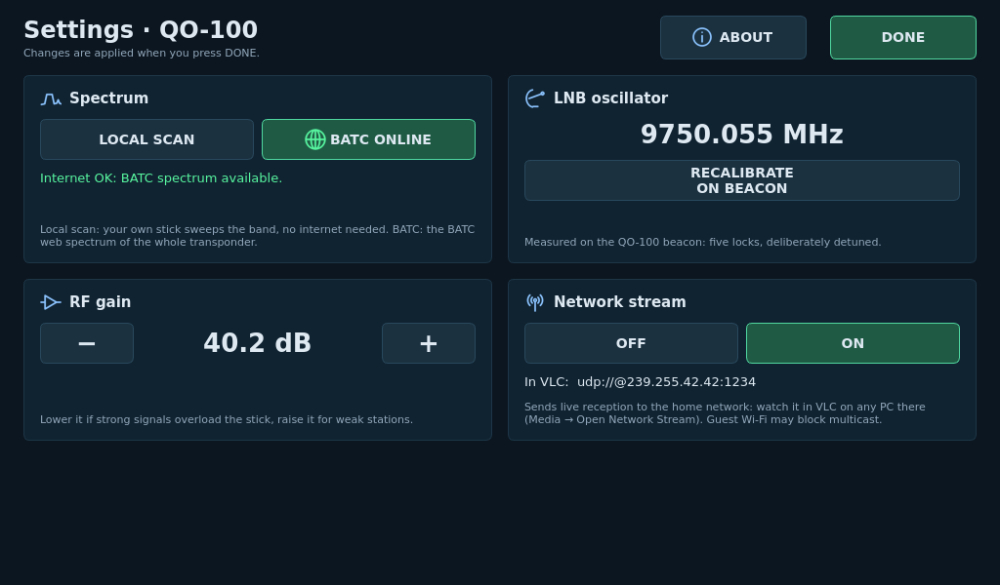

<p align="center"></p>

# DATVision

**DATVision** turns an inexpensive RTL-SDR stick, or an ADALM-Pluto, into a dedicated receiver for
digital amateur television (DVB-S and DVB-S2): QO-100 and the terrestrial ATV
bands, with spectrum, click-to-tune, video and sound in one application.

It runs on a **Raspberry Pi with a touchscreen**, as a stand-alone receiver
operated with a finger, and on **Windows**.

<p align="center"></p>

## Features

- **DVB-S and DVB-S2** reception up to 1500 kS/s with an RTL-SDR Blog V4 or R820T stick.
- **ADALM-Pluto and clones** such as the FISHBall PlutoSky (Tezuka firmware), on USB or
  on the network: found automatically and chosen in Settings.
- **QO-100** through the LNB, with the BATC web spectrum or a local scan by the
  stick itself, and LNB calibration on the beacon.
- **Terrestrial bands**: 10 m, 6 m, 4 m, 2 m, 70 cm, 23 cm, 13 cm and 6 cm (13 cm and 6 cm direct with a Pluto, 6 cm
  also through a downconverter with the stick).
- **Tap a signal to tune**: carrier and symbol rate are found automatically.
- Reception quality as Es/N0 and the MiniTioune-style **D margin**, with an
  animated **magic eye** or the live **constellation**.
- **H.264, H.265 and H.266 (VVC)** video. On the Raspberry Pi, H.266 needs
  Raspberry Pi OS Trixie.
- **Recording** to transport-stream files and **playback**.
- **Network stream** of the live reception to VLC on any PC at home.

<p align="center">



</p>

## Raspberry Pi

Raspberry Pi 5 or 4, Raspberry Pi OS 64-bit with desktop (Bookworm or Trixie),
a touchscreen and an RTL-SDR stick or an ADALM-Pluto. In a terminal on the Pi:

```sh
curl -fsSL https://github.com/HB9IIU/DATVision/releases/latest/download/install.sh | bash
```

The same command updates an existing installation and keeps its settings.
See the [Raspberry Pi guide](docs/raspberry-pi.md).

**Sound:** the simplest way is to pair a **Bluetooth speaker** with the Pi
(Bluetooth icon in the top bar of the desktop). DATVision plays through
whatever audio output the Pi uses.

## Windows

Windows 10/11 x64 and an RTL-SDR stick with the WinUSB driver (installed once
with Zadig), or an ADALM-Pluto. Download the portable ZIP from the
[latest release](https://github.com/HB9IIU/DATVision/releases/latest), extract
the whole folder and open **DATVision.exe**; no installation is needed.
See the [Windows guide](docs/windows.md).

## Documentation

- [Raspberry Pi guide](docs/raspberry-pi.md)
- [Windows guide](docs/windows.md)
- [Building from source](docs/building.md)
- [The datvrx receiver on the command line](docs/receiver.md)
- [Project structure and origin](docs/project-structure.md)

## Credits

- DVB-S/S2 decoder based on [OnAir](https://github.com/adswill/OnAir) by
  Kristijonas Adomaitis (adswill)
- LDPC decoder optimizations by Evariste Courjaud (F5OEO)
- Additional DVB-S/S2 contributions by Arclamp
- BATC spectrum and original signal finder from HB9IIU Experimental H.266 Player
- Magic eye after HB9IIU SDR-Tiouner, inspired by the Lynx DATV Receiver (G8YTZ)
- QO-100 wideband spectrum courtesy of the [BATC](https://batc.org.uk)

## Licence

GPL-3.0-or-later; see [LICENSE](LICENSE). Releases include the corresponding
source code, and the Raspberry Pi release the source of the bundled RTL-SDR
driver (GPL-2.0).
